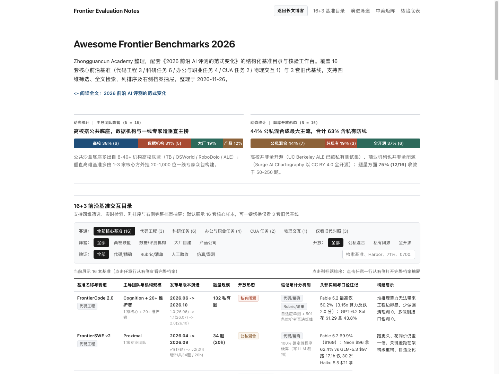

<div align="center">

# 2026 前沿 AI 评测的范式变化

[](https://zgcagi.github.io/Frontier-Benchmark/)
[](https://zgcagi.github.io/Frontier-Benchmark/benchmarks.html)
[](https://zgcagi.github.io/Frontier-Benchmark/#references)

**Zhongguancun Academy**（Chuyang Wei, Minghang Zhu, Haoxiang Guan, Jiyan He）

[在线阅读博客全文](https://zgcagi.github.io/Frontier-Benchmark/) | [从代码仓库走向物理世界](https://zgcagi.github.io/Frontier-Benchmark/#part-2) | [如何搭建有价值的 Benchmark](https://zgcagi.github.io/Frontier-Benchmark/#part-3) | [Benchmark RSI](https://zgcagi.github.io/Frontier-Benchmark/#part-4) | [Awesome 16+3 基准目录](https://zgcagi.github.io/Frontier-Benchmark/benchmarks.html)

</div>

---

## 页面与结构设计

仓库采用**“主博客 + 独立基准目录平台”**双页解耦形态（纯白学术技术博客排版，零外部字体与构建依赖，便于后续迁移英文版）：

### 1. 技术博客正文（`index.html`）
1. **一、旧 Benchmark 失效与新一代评测特征**：从 AA v5.0 隔夜换榜与官方总榜原图切入，梳理旧榜饱和后 OpenAI 与 Anthropic 的新重心，配齐 Epoch 饱和曲线、Anthropic S-1 原图与闭源三强 11 月主表实录，归纳新基准的四项核心特征。
2. **二、从代码仓库走向物理世界**：按从最容易自动验证的代码沙盒一路外扩到三维物理世界的脉络，拆解 9 个代表性案例：
   - **2.1 代码工程**：`FrontierCode 2.0`、`FrontierSWE v2`（含 SWE-bench 五代饱和图与思考预算对照）
   - **2.2 科研任务**：`TB-Science 0.1`、`De novo binder design`
   - **2.3 办公与职业任务**：`AutomationBench v1.0.6`、`AA-Briefcase v1.1`、`Remote Labor Index`
   - **2.4 CUA 任务**：`Chartography` 与 `OSWorld 2.1`
   - **2.5 物理交互**：`RoboDojo` 与 `Embodied First Exam`
3. **三、如何搭建有价值的 Benchmark**：将 16 套前沿基准各自独立的题量、团队、造题与跑榜成本、开放策略按五色领域底板并列呈现（不混算均值），提炼跨领域共性规律与五步落地行动指南。
4. **四、Benchmark RSI**：结合 `FireFlash` 与 `PostTrainBench` 分析评测环境向 Agentic RL 训练场延伸，并以 `Model x Harness x Environment` 共同进化收束。
5. **References & Citation**：60 条连续编号 `[1]`–`[60]` 核验一手来源与标准学术 BibTeX 引用块。

### 2. 独立基准目录平台（`benchmarks.html`）
- **16+3 交互目录**：按五大赛道（代码工程 3 / 科研任务 6 / 办公与职业任务 4 / CUA 任务 2 / 物理交互 1 + 旧代对照 3）、阵营、开放形态、验证机制四维筛选，支持实时检索、列排序及右侧档案抽屉；
- **五大家族演进泳道**（2023.10 至 2026.11）；
- **10 项前沿新基准中美官测跟进矩阵**；
- **读榜小字速查表与中美八厂核验底表**。

<p align="center">
  
</p>

<p align="center">
  
</p>

---

## 仓库结构与本地预览

```text
Frontier-Benchmark/
├── index.html          # 四段式专业技术博客 + References + Citation
├── benchmarks.html     # 独立 Awesome Frontier Benchmarks (16+3 检索台与核验库)
├── styles.css          # 极简纯白技术博客与目录样式（零外部字体阻塞）
├── data.js             # 单一数据源（16 核心 + 3 旧代 + 60 一手来源）
├── charts.js           # 纯原生 SVG 图表（含图 1.4 闭源三强主表转向图、16 基准独立统计与抽屉）
├── assets/             # GitHub README 预览图
├── .nojekyll           # GitHub Pages 静态直通配置
└── README.md           # 仓库说明
```

无需任何构建工具，克隆后直接启动静态服务即可本地预览：

```bash
git clone https://github.com/zgcagi/Frontier-Benchmark.git
cd Frontier-Benchmark
python3 -m http.server 8080
```

---

## Citation

```bibtex
@misc{wei2026frontier_benchmark_paradigm,
  title        = {Paradigm Shifts in Frontier AI Evaluation (2026)},
  author       = {Wei, Chuyang and Zhu, Minghang and Guan, Haoxiang and He, Jiyan},
  organization = {Zhongguancun Academy},
  year         = {2026},
  month        = {November},
  url          = {https://zgcagi.github.io/Frontier-Benchmark/}
}
```
