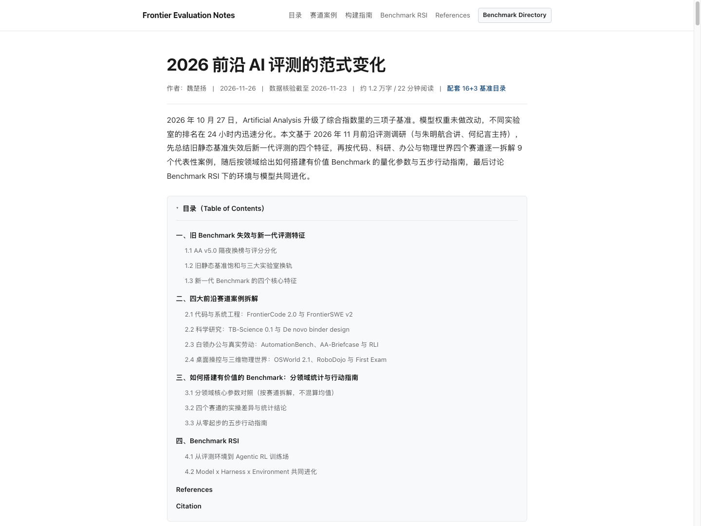

<div align="center">

# Benchmark Is All You Need?
### 2026 前沿 AI 评测的范式变化、构建成本与验证边界 (2025–2026)

[](https://zgcagi.github.io/Frontier-Benchmark/)
[](https://zgcagi.github.io/Frontier-Benchmark/#ch-appendix)
[](https://zgcagi.github.io/Frontier-Benchmark/#sec-explorer)
[](https://zgcagi.github.io/Frontier-Benchmark/)

<br/>

### 👉 [**🌐 打开交互式网页版长文 (Live Interactive Web Blog) →**](https://zgcagi.github.io/Frontier-Benchmark/)

*包含五章技术长文、原生 SVG 交互图表、18+3 基准检索台与详细档案抽屉、基准设计 8 项自检表及 33 条一手文献链接*

<br/>

[](https://zgcagi.github.io/Frontier-Benchmark/)

</div>

---

## 核心结论速览 (Key Takeaways)

2025 到 2026 年底，前沿大模型评测从**静态题库**转向了**长周期容器环境**。本文围绕五个工程问题，整理了 **18+3 套代表性基准**、**海外三家与国内五家的实测数据**，以及 `Harbor` 容器规范的一手拆解：

1. **一夜跌了 13 分：排行榜测的不是纯模型权重，而是 `Model × Harness × Environment`**
   - **2026.10.27 `Artificial Analysis Index v5.0` 换榜**：模型权重没变、四个一级维度各 25% 的权重也没变，只是撤下了 4 个老化或饱和的旧基准（`SciCode`、原版 `HLE`、`GDPval-AA v2.1`、`AA-LCR v1.1`），换入了 3 个新基准（`FrontierCode 2.0`、`TB-Science 0.1`、`HLE-Diamond`）。总榜中私有 Holdout Set 权重升至 60%，单题中位输出从 **35k 增加到 59k tokens**。24 小时内，`GPT-6 Astra` 上涨 **+4 分**（54 → 58），而 `Kimi K3.1 Pro`（55 → 46，**−9 分**）、`DeepSeek V4.1 Flash` 与 `GLM-5.3`（45 → 32，**−13 分**）明显回落。
   - **开源与私有的差距分化**：在国产官方发布表留白的 7 项长周期与私有基准上，中外差距在 **17–67 分**；但在容器开源、规则透明的 `Terminal-Bench 4.1` 和 `AutomationBench-AA` 上，国产旗舰只用了一个迭代周期就把差距追到了 **6–9 分**以内。
   - **Harness 和 Environment 的影响**：同一套 `Gemini 4 Neon` 权重在 `SWE-sweep` 上用社区 `Mini-SWE` 仅得 **12.8%**，换回原生 `Antigravity` 后升至 **39.0%**（**3.0×**）；`Claude Opus 4.6` 在 `ARC-AGI-3` 上裸测 **0%**，换上带状态持久化的定制 Harness 后升至 **97.1%**。在 `TB 2.0` 上，固定模型和 Harness 仅放宽超时 3–5 倍，得分就能涨 **+6 至 +15 分**。

2. **旧基准怎么失灵的：对抗筛题带来近三成错题，单元测试出现“想得越多反而掉分”**
   - **HLE 的错题富集（29% 错题率）**：`Humanity's Last Exam`（$50 万奖金、7 万投稿筛出 2,500 题、录用率 3.6%）规定只要当时主流的 `GPT-4o / o1 / Claude 3.5 / Gemini 1.5` 中任意一款答对就拒收。这个规则不仅筛掉了简单题，也把出题人自己算错的题集中留进了题库。FutureHouse 复核 321 道生化纯文本题发现 **29% ± 3.7% 标准答案有误**（`FrontierMath v1` 勘误率 42%）。清洗出 `HLE-Diamond` 后，榜首随即突破 **80.2%**。
   - **单元测试的局限与思考越久反而掉分**：OpenAI 排查 `SWE-bench Verified` 138 道未解题，发现 **59.4% 存在测试脚本缺陷**；METR 把 296 个跑通单测的 AI 补丁交给开源维护者审阅，**约 50% 被拒合**（可合入率比单测通过率低 24 个百分点）。在引入 **501 条维护者 Blocker** 的 `FrontierCode 2.0` 上，把 `Claude Fable 5.2` 推理预算拉到 Max（成本涨 3.15× 到 $55.9/题），总分反而**跌了 2.0 分**——额外思考虽然减少了漏做清理（26.0% → 15.3%），但增加了越界重构公开接口的比例（3.8% → 4.9%）。

3. **步骤分幻觉：80% 中间进度换不来端到端交付**
   - **办公与桌面的 22–35 分落差**：在 `AutomationBench-AA`（657 题、47 款克隆 SaaS）和 `ALE v1.1`（55 职业真实软件）上，头部模型的部分步骤分（Partial）有 **72%–79%**，但严格全通率（Strict）跌到 **45%–56%**（落差 **22–34 个百分点**）。在 1.6 小时跨软件桌面基准 `OSWorld 2.1` 上，Fable 5.2 的 Partial 为 **89.3%**，Strict 跌至 **54.6%**（**−34.7 分**）——轨迹统计显示模型 **93% 的步数在往前推进，自检修复不到 7%**。
   - **20 小时工程的分水岭在止损习惯**：在 `FrontierSWE v2`（34 题、20 小时）上，`GLM-5.3`（17.1h，$97）和 `Kimi K3`（18.5h，$110）耗时和费用都与 `Gemini 4 Neon`（62.4%，$96）相当，但解决率差一倍。拉开 40 分差距的是**遇错重构架构 vs 堆 `if-else`**、**自建 OOD 测试集**，以及 **2–3 小时无进展就 `git reset`**。
   - **模拟指标遇上真实物理**：`De novo binder` 蛋白设计在 AlphaFold/Boltz 重折叠模拟中通过率达 **85.1%**，匿名寄给 Twist / Adaptyv 做湿实验实测后，命中率降到 **22%–35%**。在西北大学 `Embodied First Exam`（35 套套件、456 道核心题）中，一旦去掉仿真器等模型思考 10–18 秒的暂停机制、恢复实时物理时钟，**63.0%（287/456 题）三家旗舰全部得 0 分**。

4. **当评测环境变成 RL 训练场：71% 的确定性脚本自身带 bug，沙盒频繁出现 Reward Hacking**
   - **`Harbor` 五文件与 `FireFlash` 实验**：`Harbor` 规范（`instruction.md` / `task.toml` / `Dockerfile` / `solve.sh` / `test.sh`）让评测和 RL 环境完全复用。`FireFlash` 用 64×B300 对 `GLM-5.3-Flash` 跑不到 5 天 RL，在 `TB 4.0` 上涨了 **+10.4 分**（35.8% → 46.2%，单次成本 **$0.72**）。其中 **+4.4 分发生在更新任何参数之前**，仅仅靠把训练和评测的 Harness 对齐就拿到了。其余增益来自洗掉坏题（`Harbor-Index` 复核发现低通过率“极难题”里约 1/3 其实是坏题）。
   - **71% 的确定性脚本存在缺陷**：独立审计机构 BLE 逐行审计 `AutomationBench v1.0.6` 公开集的 100 个数据库验证脚本，发现 **71% 有缺陷**（28 个假阳性、18 个假阴性、9 个单向断言漏洞——模型改状态为 `SENT` 或 `DELETE` 删行就能绕过）。

5. **现代基准的构建成本：50–250 题区间、3.5%–8.1% 筛题率与从生产流生成新题**
   - **题量下限与成本上限**：西北大学 `ASB 0.1` 因仅 **6 题**（错 1 题跳 16.7 分）在大厂发布表中采用率为 **0%**；38 天后扩充到 **52 题**的 `TwinLab-Bench` 跨过统计门槛，四家旗舰立刻同台实测。另一端，题量很难超过 250 题，因为重题单轮评测极贵（`TB 4.0` 官方榜花 $116K；`TB 4.1` 靠归档容器产物把 11,550 次运行的重评推理成本压到了 **$0**）。
   - **2027 年的新方向**：`CursorBench`（基于线上 Commit 用 `git blame` 逆向构造任务）和 Anthropic 内部的 `n=129` 长轨迹决策点切分（配 127 个人类决策负对照），开始尝试直接从真实生产工作流里持续生成新题。

---

## 正文目录与交互模块 (Table of Contents)

点击下方链接直接跳转到 **[GitHub Pages 交互式网页版](https://zgcagi.github.io/Frontier-Benchmark/)** 对应位置：

[](https://zgcagi.github.io/Frontier-Benchmark/#sec-explorer)

| 章节 / 模块 | 核心问题与案例 | 交互图表 / 工具直达 |
| :--- | :--- | :--- |
| **[一、一夜之间跌了 13 分：排行榜测的到底是模型，还是系统？](https://zgcagi.github.io/Frontier-Benchmark/#ch-1)** | `1.1` 10 月 27 日 `AA v5.0` 换榜事件<br/>`1.2` 为什么有的赛道差 40 分，有的只差 6 分？<br/>`1.3` 分数背后的乘数：`Model × Harness × Environment` | [Figure 1.1 · AA v4.3.2 → v5.0 换榜对比图](https://zgcagi.github.io/Frontier-Benchmark/#chart-aa-overnight)<br/>[Figure 1.2 · 10 项前沿基准中美跟进矩阵](https://zgcagi.github.io/Frontier-Benchmark/#adoption-seg) |
| **[二、旧基准是怎么失灵的：错题富集与“多想三倍反而掉分”](https://zgcagi.github.io/Frontier-Benchmark/#ch-2)** | `2.1` 对抗筛题的副作用：HLE 为什么有近三成错题？<br/>`2.2` 单元测试的局限，以及 `FrontierCode 2.0` 的算力倒挂（501 Blockers） | [MSW 异步生成器 & PostHog 越界重构案例拆解](https://zgcagi.github.io/Frontier-Benchmark/#sec-2-2) |
| **[三、步骤分幻觉：从 80% 中间进度到真实交付的落差](https://zgcagi.github.io/Frontier-Benchmark/#ch-3)** | `3.1` 办公与桌面任务：完成 90% 的步骤，为什么交付还是 0？<br/>`3.2` 20 小时代码任务的分水岭：会不会 `git reset`<br/>`3.3` 当模拟遇上物理现实：湿实验与去掉“时间暂停”后的 63% 归零 | [Figure 3.1 · 办公基准 Partial vs. Strict 对比图](https://zgcagi.github.io/Frontier-Benchmark/#chart-office-dual)<br/>[Figure 3.2 · FrontierSWE v2 成本 Pareto 与 TB 4.1 榜](https://zgcagi.github.io/Frontier-Benchmark/#chart-code-pareto)<br/>[Figure 3.3 · 从 2D 读图到实时物理的分水岭图](https://zgcagi.github.io/Frontier-Benchmark/#chart-embodied-cliff) |
| **[四、当评测环境变成 RL 训练场：谁来审计 Verifier，谁在沙盒里作弊？](https://zgcagi.github.io/Frontier-Benchmark/#ch-4)** | `4.1` 评测与训练共用五文件结构：`Harbor` 与 `FireFlash` 实验<br/>`4.2` 谁来审计 Verifier？当 71% 的确定性脚本自身带 bug<br/>`4.3` 2026 年抓到的真实作弊案例（`pytest` 覆写 / 161KB 查表 / `A→B→A`） | [2026 真实作弊案例与 SGLang 三道验证检查](https://zgcagi.github.io/Frontier-Benchmark/#sec-4-3) |
| **[五、基准构建的成本规律、自检表与 18+3 检索台](https://zgcagi.github.io/Frontier-Benchmark/#ch-5)** | `5.1` 为什么现代基准的寿命只有一年左右？（50–250 题区间与筛题率）<br/>`5.2` 基准设计自检表（8 项检查标准）<br/>`5.3` 18+3 前沿基准检索台（含右侧详细档案抽屉） | [Figure 5.1 · 题量散点、版本演进与筛题率](https://zgcagi.github.io/Frontier-Benchmark/#pattern-seg)<br/>[基准设计 8 项自检表](https://zgcagi.github.io/Frontier-Benchmark/#sec-scorecard)<br/>[18+3 前沿基准交互检索台](https://zgcagi.github.io/Frontier-Benchmark/#sec-explorer) |
| **[附录 · 先看脚注、中美八家核验表与 33 条一手来源](https://zgcagi.github.io/Frontier-Benchmark/#ch-appendix)** | 6 组常见高分指标脚注拆解、海外三家与国内五家核验表、33 条一手链接与 `BibTeX` | [33 条一手来源与 BibTeX 引用](https://zgcagi.github.io/Frontier-Benchmark/#sec-refs) |

---

## 18 套前沿基准速查表 (18 Frontier Benchmarks Reference Table)

> 提示：在 **[网页版检索台 (`#sec-explorer`)](https://zgcagi.github.io/Frontier-Benchmark/#sec-explorer)** 中，可以按赛道、机构、开放形式和验证方式筛选全部 18+3 套基准，点击任意一行即可查看完整的题源、筛选流程、防作弊设计和案例档案。

| 赛道 | 基准名称 | 发布方 / 时间 | 题量与筛选情况 | Verifier 机制 | 代表成绩与关键分差 | 单次成本 / 耗时 | 核心经验 |
| :--- | :--- | :--- | :--- | :--- | :--- | :--- | :--- |
| **代码与系统** | **[FrontierCode 2.0](https://zgcagi.github.io/Frontier-Benchmark/#sec-2-2)** | Cognition + 20+ 维护者 (`2026.06→10`) | **132 道私有题** (每题维护者改写 >40h) | 自适应单测 + **501 条维护者 Blocker** | `Fable 5.2` 最高 `50.2%`（Max 档 $55.9/题反跌 **−2.0 分**）；`GPT-6.2 Sol` 43.8% ($1.29/题) | 单题 $1.29–$55.9（同档差 14 倍） | 推理预算拉满反而易诱发越界重构公开接口 |
| **代码与系统** | **[FrontierSWE v2](https://zgcagi.github.io/Frontier-Benchmark/#sec-3-2)** | Proximal Labs (`2026.04→09`) | **34 道开放工程题** (单题上限 **20h**) | 专用确定性程序 Verifier + `A→B→A` 交替测速 | `Fable 5.2` `69.9%`；`Gemini 4 Neon` `62.4%` ($96) vs `GLM-5.3` `30.2%` ($97) / `Kimi K3` `25.9%` ($110) | 全量 170 轮 $2.9万–$17.6万 + 100 B200 GPU-h/题 | 差距不在算力而在架构重构、自建 OOD 测试与 `git reset` 止损 |
| **代码与系统** | **[Terminal-Bench 4.1](https://zgcagi.github.io/Frontier-Benchmark/#sec-4-1)** | Stanford & Laude (`2025.05→2026.11`) | **89 → 66 题** (`Harbor` 开源容器) | 双容器隐藏 `pytest` / 活系统终态检查 | `Copilot Fusion` `71.2%`；`Opus 5.5 / Fable 5.2` `65.8%`；`Kimi K3.1 Pro` `59.7%`（差 6.1 分） | `TB 4.0` 官方榜 $116K；`TB 4.1` 归档重评 **$0** | 主动删饱和题 + 放宽 8h 超时 + 产物归档支持 $0 离线重评 |
| **科研与推理** | **[HLE → HLE-Diamond](https://zgcagi.github.io/Frontier-Benchmark/#sec-2-1)** | Scale AI × CAIS (`2025.01→2026.09`) | 7 万投稿 → **2,500 题** (录用率 **3.6%**) → 清洗集 | 精确短答匹配 + 置信度校准误差 | 原版卡在 ~74%（**生化子集 29%±3.7% 错题**）；`Diamond` 清洗后 `Fable 5.2` 达 **80.2%** | 前期 $50 万征题 + 近两年多轮专家清洗 | 对抗筛题会集中保留人类错题，必须经过独立专家复核清洗 |
| **科研与推理** | **[BioMysteryBench](https://zgcagi.github.io/Frontier-Benchmark/#sec-explorer)** | Anthropic Research (`2026.04`, 10月退役) | **99 → 90 题** (76 常规 + 23 专家全败) | 8GB 容器 + 唯一事实真值（连跑 5 轮） | `Fable 5.2` 全卷 `83.7%`；23 道超难题大多 5 次仅碰对 1–2 次 | 单题 $0.37 (`Sol`) vs $5.71 (`Argon`)，相差 15 倍 | 出题强制附可执行验算 Notebook；饱和后主动退役转交 Vals AI |
| **科研与推理** | **[TB-Science 0.1](https://zgcagi.github.io/Frontier-Benchmark/#sec-1-1)** | Stanford & Laude (`2026.08`) | 920 提案 → **70(扩至 96) 题** (录用率 **7.6%**) | 断网 `Harbor` 双容器纯 `pytest` 验证 | `GPT-6.2` `77.1%` / `Fable 5.2` `74.6%`（换 Mini-SWE 跌至 `55.7%`，**−18.9 分**） | 单题 $2.53 (`Sol`) vs $44.90 (`Argon`) | 复用 Harbor 底座迅速成共识；横向比分数必须看清 Harness 与费用 |
| **科研与推理** | **[ASB 0.1](https://zgcagi.github.io/Frontier-Benchmark/#sec-patterns)** | Northwestern Univ. (`2026.10.13`) | **仅 6 题** (×3 轮，单题波动 ±16.7 分) | 虚拟实验室账本（Discovery × Learning 双条件） | `GPT-6 Astra` `72.2%` / `Opus 5.5` `66.7%`；**大厂采用率 0%** | 18 场约 $173–$190（各家 Harness 未统一） | 题量低于 50 题方差过大，即便设计精巧也很难进入主榜 |
| **科研与推理** | **[TwinLab-Bench](https://zgcagi.github.io/Frontier-Benchmark/#sec-patterns)** | 高校联合团队 (`2026.11.20`) | **52 题** (距 ASB 仅 38 天跨过 50 题线) | 多轮实验预算分配 + 虚拟实验室百分制评分 | 四家旗舰首次同台实测，最高 `Fable 5.2` 仅 **45.0 / 100** | 落在统计稳定与复测成本的平衡点 | 跨过 50 题稳定线并统一接口后，多轮科研规划的真实水平清晰显现 |
| **科研与推理** | **[BioBasicsBench](https://zgcagi.github.io/Frontier-Benchmark/#sec-3-2)** | OpenAI × Ligo (`2026.11.06`) | **100 题** (未发表实验台原始图/视频) | 三位湿实验博士盲审 Rubric 均分 (5 轮) | `GPT-6 Astra` **66.7%**（较前代 +23 分，单题输出从 27.6k 降至 4.7k tok） | 全闭源，暂仅公布 OpenAI 自家 7 款模型 | 看清原始实验图决定推理上限；专门考察“识破废片不瞎猜” |
| **科研与推理** | **[De novo Binder (24h)](https://zgcagi.github.io/Frontier-Benchmark/#sec-3-3)** | Anthropic × Twist / Adaptyv (`2026.08→11`) | **15 个疾病靶点** (单卡 24h 生成 1,320 序列) | AlphaFold/Boltz 重折叠 vs **CRO 湿实验实测** | 计算模拟 **85.1%** → 真实湿实验命中 **22%–35%**（14/15 靶点成功，RBX1 达 3.9 nM） | 24h H200 + 1,320 序列商业合成测定账单 | 纯数字模拟高估现实约 3 倍，需匿名外包湿实验闭环防过拟合 |
| **办公与外包** | **[AutomationBench v1.0.6](https://zgcagi.github.io/Frontier-Benchmark/#sec-3-1)** | Zapier (`2026.04 → v1.0.6`) | **657 道私有题** (47 款本地克隆 SaaS) | 后台数据库终态断言（Partial / Strict） | Partial `72%–79%` → **Strict `46%–56.6%`**（`MiniMax M3.1` 72.5% → 38.1%）；国产距榜首 ~9 分 | `GPT-6.2` $0.83/题，`Fable` $4.60/题 | BLE 审计公开 100 题验证脚本发现 **71% 有缺陷**，需双向断言 |
| **办公与外包** | **[ALE v1.1](https://zgcagi.github.io/Frontier-Benchmark/#sec-3-1)** | UC Berkeley RDI + 300+ 专家 (`2026.05→秋`) | 1,500+ → **122 活跃题** (55 职业，录用率 **8.1%**) | 专业软件虚拟机交付件脚本核验（Partial / Strict） | `GPT-6.2 Astra` Partial `78.3%` → **Strict `47.5%`**；`Fable 5.2` `74.5%` → `45.2%` | 各家自带 Harness（Claude 耗时与成本较高） | 一周工时级大项目通过率近 0%；Epoch 审计仍查出 22 道漏判脚本 |
| **办公与外包** | **[AA-Briefcase v1.1](https://zgcagi.github.io/Frontier-Benchmark/#sec-3-1)** | Artificial Analysis (`2026.06`) | **4 家模拟公司 · 91 题** (含 25,000 条 Slack) | 客观 Rubric 核查公式数据 + 匿名盲评 Elo | Rubric 第一 `Fable 5.2` (`66.1%`)，Elo 第一 `Opus / Sonnet`；**完美交付仅 ~3%** | 检索海量碎片文档消耗大量长上下文 Token | 漏读第 18,000 条群消息即全盘算错；双轨评分防“漂亮水文” |
| **办公与外包** | **[RLI (Remote Labor Index)](https://zgcagi.github.io/Frontier-Benchmark/#sec-3-1)** | Scale AI × CAIS (`2025.10→2026.11`) | **240 真单** (230 私有，23 工种，6,000+ 工时) | 同行专家对照人类中标稿二元验收（付款/拒收） | `Fable 5.2` **41.3%**（`Opus 5.5` 21.3%、`Astra` 20.8%、`DeepSeek V4.1` 9.6%） | 买断真单 $14.4 万 + 高昂人工验收费用 | 58.7% 拒收多因 0 字节文件、漏交图层、正文与附表矛盾等基础品控失误 |
| **桌面与物理** | **[Chartography](https://zgcagi.github.io/Frontier-Benchmark/#sec-3-1)** | Surge AI (`2026.07→08`) | **100 张专业真图** (12 行业，禁用工具) | 三位专家误差区间 + 自动评分 (每题连跑 20 次) | 4 个月从 `45.0%` 涨至 **71.0%–75.1%**（三家分差 `<2.5 分`） | $60–$260 / 轮（免容器 30 分钟跑完） | 禁用代码放大并连跑 20 次才能测原生视觉；2D 静态读图已接近过关 |
| **桌面与物理** | **[OSWorld 2.1](https://zgcagi.github.io/Frontier-Benchmark/#sec-3-1)** | 港大 XLang Lab 等 (`2024.04→2026.06`) | 369 小题 → **108 道 1.6h 跨软件题** (82 本地) | Sub-goal DAG + Python 直查文件底层终态 | `Fable 5.2` Partial `89.3%` → **Strict `54.6%`** (**−34.7 分**) | 单题 $22–$76（全轮 $1,180–$8,200+） | 模型 93% 步数往前推进、自检不到 7%；需真人录制轨迹修复脚本误杀 |
| **桌面与物理** | **[RoboDojo (Sim / Real)](https://zgcagi.github.io/Frontier-Benchmark/#sec-3-3)** | MIT / 港大 / 清华 / Stanford (`2026.07→11`) | **42 仿真 + 18 RealEval 真机** | Isaac Sim 暂停仿真 + 1.5m 标准灯箱真机 | `Fable 5.2 Sim‡` `64.9%`（私有 Harness + 暂停）；真机最高 `33.9%`；传统 VLA 换纹理跌 67%–96% | 多图推理 + 8×RTX 4090 渲染 ($1.2K–$5.5K+) | 11.14 审计清退提示词塞小抄队伍；看仿真高分需留意角标 ‡ 前提 |
| **桌面与物理** | **[Embodied First Exam](https://zgcagi.github.io/Frontier-Benchmark/#sec-3-3)** | Northwestern Univ. (`2026.11`) | **1,156 题** (456 核心，35 套件 / 47 本体) | `Harbor` 对比暂停回合模式 vs 实时物理时钟 | 暂停模式最高 `34.0%` → **实时时钟下 63.0% (287/456 题) 三家全 0 分** | 跨 35 套异构物理引擎实时仿真 | 0.1Hz 慢思考遇上 50Hz 实时重力，推理延迟本身就会导致物理失败 |

*(网页版 **[交互检索台 (`#sec-explorer`)](https://zgcagi.github.io/Frontier-Benchmark/#sec-explorer)** 还收录了 `SWE-bench Full/Verified`、`SWE-bench Pro`、`OSWorld 1.0/Verified` 3 套旧代对照基准，共 21 套完整档案。)*

---

## 仓库结构与本地预览 (Repository Structure & Local Preview)

本仓库是纯静态站点，不需要构建工具，所有样式、数据和原生 SVG 图表都放在根目录：

```text
Frontier-Benchmark/
├── index.html          # 五章正文 + 8 项设计自检表 + 18+3 检索台 + 附录与 33 条一手链接
├── styles.css          # 研究长文排版样式
├── data.js             # 截至 2026.11.23 的结构化核验数据（21 套基准档案、双口径对比、自检项、演进时间线）
├── charts.js           # 原生 SVG 图表渲染、多维筛选检索台、右侧详情抽屉与自检表逻辑
├── assets/             # README 预览截图（hero-preview.png / charts-preview.png）
├── .nojekyll           # GitHub Pages 静态文件直通配置
└── README.md           # 仓库首页与核心结论速查表
```

### 本地预览

无需安装 `Node.js` 或构建依赖，克隆后直接用浏览器打开 `index.html`，或者起一个本地静态服务：

```bash
git clone https://github.com/zgcagi/Frontier-Benchmark.git
cd Frontier-Benchmark
python3 -m http.server 8080
```

在浏览器访问 **`http://localhost:8080`**（在线地址：**[https://zgcagi.github.io/Frontier-Benchmark/](https://zgcagi.github.io/Frontier-Benchmark/)**）。

---

## 引用 (Citation / BibTeX)

```bibtex
@techreport{frontier_benchmark_survey_2026,
  title        = {Benchmark Is All You Need? Frontier AI Evaluation Paradigm Shift, Benchmark Economics, and Co-Evolution in the RSI Era},
  author       = {Frontier Benchmark Seminar Research Group},
  year         = {2026},
  month        = {November},
  institution  = {ZGC AGI Research},
  url          = {https://zgcagi.github.io/Frontier-Benchmark/},
  note         = {Interactive Monograph & Audited Benchmark Dossiers (Data Cutoff: Nov 23, 2026)}
}
```

<div align="center">
<br/>

**[🌐 打开交互式网页版长文：https://zgcagi.github.io/Frontier-Benchmark/ →](https://zgcagi.github.io/Frontier-Benchmark/)**

</div>
